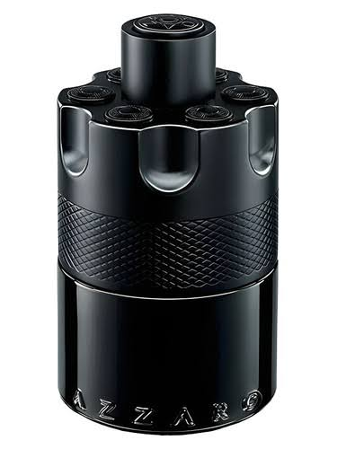

# 🧴 Fragrance Log & Recensioni

La mia collezione personale e recensioni oneste dei profumi che ho testato. Ogni fragranza è divisa in base alla stagione migliore in cui indossarla, con le sue note, le prestazioni reali e i voti sia per uomo che per donna.

---

## 📑 Stagioni
* [❄️ Inverno / Climi Freddi](#️-inverno--climi-freddi)
* [🍂 Autunno / Mezza Stagione](#-autunno--mezza-stagione)
* [🌸 Primavera / Uso Quotidiano](#-primavera--uso-quotidiano)
* [☀️ Estate / Climi Caldi](#️-estate--climi-caldi)

---

## ❄️ Inverno / Climi Freddi

### 1. Althaïr — Parfums de Marly

> *"Una vaniglia cremosa e morbida unita a spezie calde e legni: dolce, avvolgente e molto elegante."*

* **Note:**
  * **Testa:** Cannella, Cardamomo, Fiore d'Arancio, Bergamotto
  * **Cuore:** Vaniglia Bourbon, Elemi
  * **Fondo:** Pralina, Muschio, Ambroxan, Legno di Guaiaco
* **Cosa dicono gli utenti:** Amato come uno dei migliori profumi dolci maschili del momento. Tutti elogiano l'ottima qualità della vaniglia, anche se molti trovano il prezzo piuttosto alto.

| Stagione | Spruzzi | Longevità | Proiezione | Voto Uomo | Voto Donna |
| :--- | :---: | :---: | :---: | :---: | :---: |
| **Inverno / Autunno** | `3 - 4` | 9 - 11 ore | Forte | **4.6 / 5** | **4.2 / 5** |

---

### 2. Oud for Greatness — Initio Parfums Privés

> *"Un profumo legnoso intenso e speziato, bilanciato da zafferano dolce e lavanda fresca che trasmette sicurezza."*

* **Note:**
  * **Testa:** Zafferano, Noce Moscata, Lavanda
  * **Cuore:** Legno di Agar (Oud)
  * **Fondo:** Patchouli, Muschio
* **Cosa dicono gli utenti:** Famoso per avere prestazioni mostruose. Piace molto per il suo carattere deciso, anche se qualcuno trova che ricordi un po' troppo *Baccarat Rouge 540*.

| Stagione | Spruzzi | Longevità | Proiezione | Voto Uomo | Voto Donna |
| :--- | :---: | :---: | :---: | :---: | :---: |
| **Inverno** | `2 - 3` | 12+ ore | Molto Forte | **4.4 / 5** | **3.7 / 5** |

---

### 3. The Most Wanted (Eau de Parfum Intense) — Azzaro

> *"Caramello mou fuso e cardamomo caldo su un fondo di legni ambrati: deciso, seducente e perfetto per la sera."*

* **Note:**
  * **Testa:** Cardamomo
  * **Cuore:** Caramello Toffee
  * **Fondo:** Amberwood
* **Cosa dicono gli utenti:** Una garanzia per ricevere complimenti negli appuntamenti e nelle serate fredde. Apprezzatissimo perché è dolce, avvolgente e dura tantissimo per essere un profumo commerciale.

| Stagione | Spruzzi | Longevità | Proiezione | Voto Uomo | Voto Donna |
| :--- | :---: | :---: | :---: | :---: | :---: |
| **Inverno / Autunno** | `3 - 4` | 8 - 10 ore | Forte | **4.6 / 5** | **3.8 / 5** |

---

## 🍂 Autunno / Mezza Stagione

### 4. Ombré Leather (Eau de Parfum) — Tom Ford

> *"Pelle nera morbida con un tocco di fiori bianchi e spezie, che la rende liscia e facile da indossare."*

* **Note:**
  * **Testa:** Cardamomo
  * **Cuore:** Cuoio, Gelsomino Sambac
  * **Fondo:** Ambra, Muschio Vegetale, Patchouli
* **Cosa dicono gli utenti:** Uno dei migliori profumi al cuoio sul mercato. Piace perché è molto realistico e portabile senza risultare troppo aggressivo.

| Stagione | Spruzzi | Longevità | Proiezione | Voto Uomo | Voto Donna |
| :--- | :---: | :---: | :---: | :---: | :---: |
| **Autunno / Inverno** | `3 - 4` | 9 - 10 ore | Moderata - Forte | **4.7 / 5** | **3.9 / 5** |

---

### 5. Baccarat Rouge 540 — Maison Francis Kurkdjian

> *"Un mix leggero e arioso di zucchero caramellato, zafferano e legni caldi che lascia una scia indimenticabile."*

* **Note:**
  * **Testa:** Zafferano, Gelsomino
  * **Cuore:** Amberwood, Ambra Grigia
  * **Fondo:** Resina di Abete, Legno di Cedro
* **Cosa dicono gli utenti:** Un enorme successo moderno. Famoso per attirare complimenti, anche se chi lo indossa spesso smette di sentirlo dopo poco per assuefazione ed è stato imitato ovunque.

| Stagione | Spruzzi | Longevità | Proiezione | Voto Uomo | Voto Donna |
| :--- | :---: | :---: | :---: | :---: | :---: |
| **Autunno / Primavera** | `3 - 4` | 10+ ore | Forte | **4.1 / 5** | **4.8 / 5** |

---

### 6. Encre Noire — Lalique

> *"Un profumo scuro, terroso e legnoso che ricorda un bosco umido dopo la pioggia e l'inchiostro nero."*

* **Note:**
  * **Testa:** Cipresso
  * **Cuore:** Vetiver di Bourbon, Vetiver di Haiti
  * **Fondo:** Legno di Cashmere, Muschio
* **Cosa dicono gli utenti:** Un vero cult perché odora molto più costoso di quello che costa. Non è pensato per piacere a tutti, ma gli appassionati adorano il suo stile cupo e unico.

| Stagione | Spruzzi | Longevità | Proiezione | Voto Uomo | Voto Donna |
| :--- | :---: | :---: | :---: | :---: | :---: |
| **Autunno** | `4 - 5` | 6 - 8 ore | Ravvicinata - Moderata | **4.2 / 5** | **2.8 / 5** |

---

## 🌸 Primavera / Uso Quotidiano

### 7. Aventus — Creed

> *"Ananas fresco e agrumi frizzanti su una base di legno affumicato: il profumo quotidiano sicuro per eccellenza."*

* **Note:**
  * **Testa:** Bergamotto, Ribes Nero, Mela, Limone, Pepe Rosa
  * **Cuore:** Ananas, Patchouli, Gelsomino del Marocco
  * **Fondo:** Betulla, Muschio di Quercia, Muschio, Ambroxan, Legno di Cedro
* **Cosa dicono gli utenti:** Il profumo maschile più famoso degli ultimi 15 anni. Tutti amano quanto sia versatile, anche se le produzioni recenti durano meno rispetto a quelle vecchie.

| Stagione | Spruzzi | Longevità | Proiezione | Voto Uomo | Voto Donna |
| :--- | :---: | :---: | :---: | :---: | :---: |
| **Primavera / Estate / Tutto l'anno** | `4 - 5` | 7 - 8 ore | Moderata | **4.8 / 5** | **3.5 / 5** |

---

### 8. Mercy — Spirit of Kings

> *"Un mix luminoso e pulito di agrumi freschi e spezie leggere su una base morbida di fiori e vaniglia calda."*

* **Note:**
  * **Testa:** Pompelmo, Bergamotto, Zenzero, Noce Moscata
  * **Cuore:** Geranio, Gelsomino, Rosa, Mughetto
  * **Fondo:** Ambra, Muschio, Vaniglia, Legno di Cedro
* **Cosa dicono gli utenti:** Elogiato per essere pulito, morbido ed elegante. Ottimo per vestirsi bene o da indossare in ufficio.

| Stagione | Spruzzi | Longevità | Proiezione | Voto Uomo | Voto Donna |
| :--- | :---: | :---: | :---: | :---: | :---: |
| **Primavera / Autunno** | `3 - 4` | 8 - 9 ore | Moderata | **4.3 / 5** | **4.5 / 5** |

---

## ☀️ Estate / Climi Caldi

### 9. Light Blue Pour Homme — Dolce & Gabbana

> *"Agrumi freschi del Mediterraneo con un tocco pulito, erbaceo e leggermente pepato pensato per le giornate calde."*

* **Note:**
  * **Testa:** Pompelmo, Bergamotto, Mandarino di Sicilia, Ginepro
  * **Cuore:** Pepe, Rosmarino, Legno di Rosa Brasiliano
  * **Fondo:** Muschio, Incenso, Muschio di Quercia
* **Cosa dicono gli utenti:** Un classico estivo perfetto per il caldo e i giorni casual. Piace perché è fresco e pulito, anche se svanisce abbastanza in fretta.

| Stagione | Spruzzi | Longevità | Proiezione | Voto Uomo | Voto Donna |
| :--- | :---: | :---: | :---: | :---: | :---: |
| **Estate** | `6 - 8` | 4 - 5 ore | Ravvicinata | **4.0 / 5** | **3.2 / 5** |
